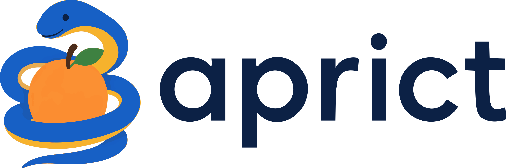

# Description
`aprict` is a Python module for simulating transmission experiments in X-ray Computed Tomography, and for performing reconstructions from real and simulated data. In addition to the Python API, there is a commandline interface for some common operations.

## Disclaimer
This software is provided with no warranty or guarantee of correctness. This is my research code sandbox, subject to breaking changes on a whim. This is not mature software. So, if you like it and wish to use it, then it is best to download a fixed version and use that. Updates may break things.

## Features
`aprict` uses the GPU for all the heavy operations. The terminology 'in-core' an 'out-of-core' here refers to whether the relevant data must fit entirely within the GPU VRAM (in-core) or not (out-of-core). Most operations have no minimum RAM requirement in practice. Included features as of aprict==0.0.33:

 - Out-of-core calculation of projection data for arbitrary flat-panel geometries. Supports voxelised volumes and (almost) any FORBILD phantom. (Exact line integrals in all cases.)
 - Out-of-core analytic reconstruction for special geometries:
   - Fan-beam data with circular scan
   - Cone-beam data with cylindrical scan
 - In-core iterative reconstruction (Landweber and SIRT) for arbitrary geometries.

# Documentation
## Viewing online
The documentation for the latest release can be viewed online at [`https://docs.aprict.au/`](https://docs.aprict.au/). 
## Viewing locally
The documentation may be viewed locally by cloning the repository and running `python3 -m http.server -d aprict/docs/ 8080`, then navigating to `http://localhost:8080` in a browser window.

# Caveats
## Hardware Requirements
This software requires at least one relatively recent *CUDA-capable GPU*. An RTX 3090 is recent enough. The relevant drivers will also need to be installed. You may need up-to-date drivers, depending on when the code was last updated.

It is strongly recommended to use high-speed mass storage, such as an NVMe drive. The software has not been tested on slower mass storage, and is not expected to perform well without it.

This software has been tested with the following GPUs: 
* NVIDIA RTX 3090
* NVIDIA RTX PRO 6000 Blackwell

## Known limitations
* Only flat-panel X-ray data with square pixels is supported, at this time.
* Lack of documentation:
  * The way that geometry is encoded in `*.json` files is not yet documented.
  * The encoding of projection data and volume data is not yet documented. (Numpy arrays; memory-mapped in the case of projections.)
* Implementation-related issues which could be alleviated in the future:
  * Volume size is limited by CUDA texture limit. For example, a `(2400,2400,4800)` volume can be reconstructed, but not a `(30000,30000,1)` volume, due to a volume of this size not fitting within a single CUDA texture
  * The FORBILD shape `Tetrahedron` is not yet implemented, and no primitive shape is permitted to have more than 3 clipping planes applied, due to internal limitations. All other FORBILD phantoms should be supported.
  * Only one GPU is utilised by this module, at the present time. There is no defined behaviour for which GPU will be chosen.
  * Not fully optimised
  * CPU and GPU work not completely asynchronous: due to unresolved bugs, various asynchronous GPU operations have been disabled. This may not have much impact on large reconstructions, but could result in poor GPU utilisation for smaller reconstructions.
  * No smart batching of (back)projections: smarter code would analyse the geometry of projections, and batch together (back)projections that involve similar regions of the volume. Currently, the code does not do any kind of clever batching like this, and so the (back)projection code is not as performant as it could be.

